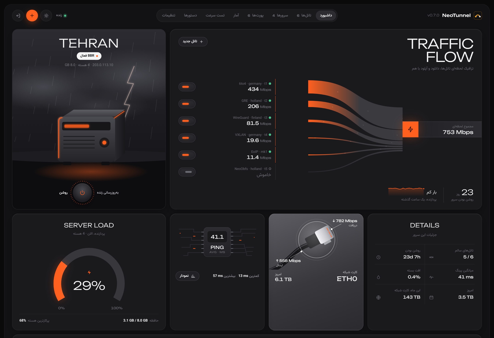
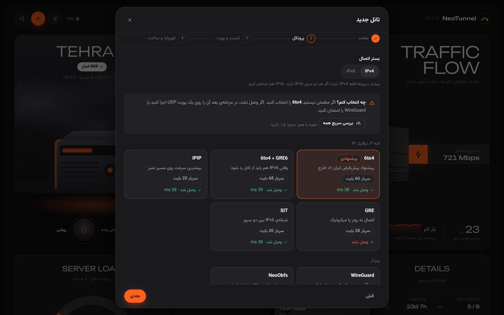
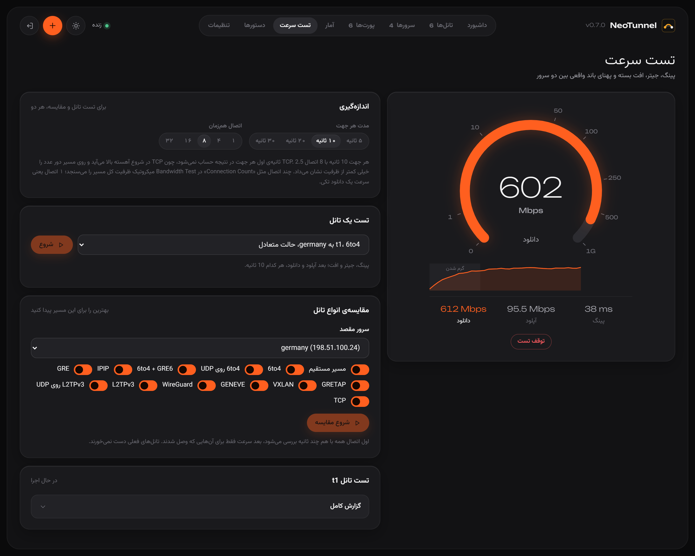
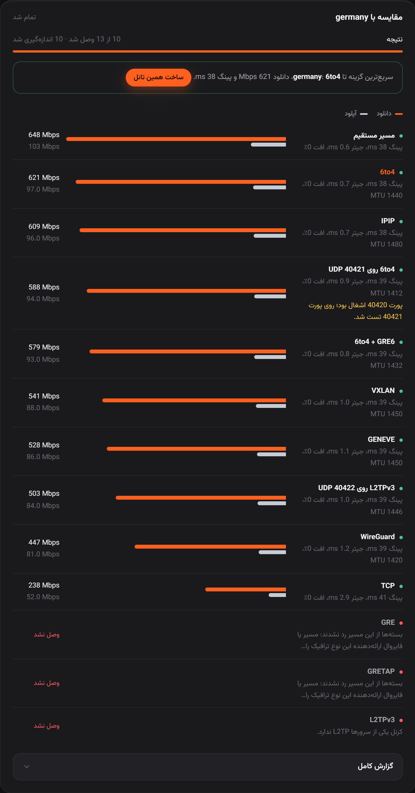
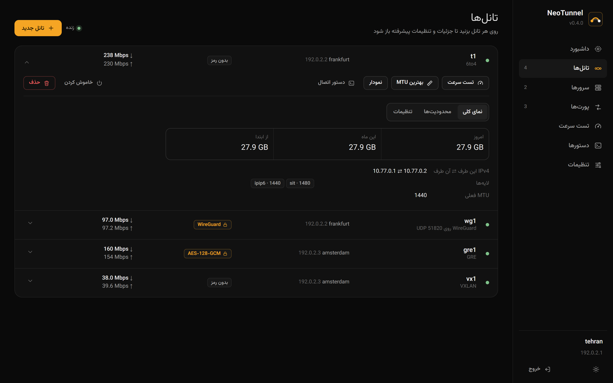
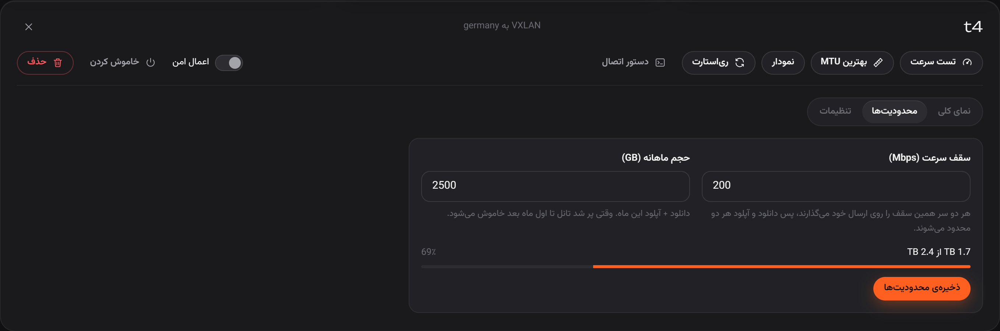
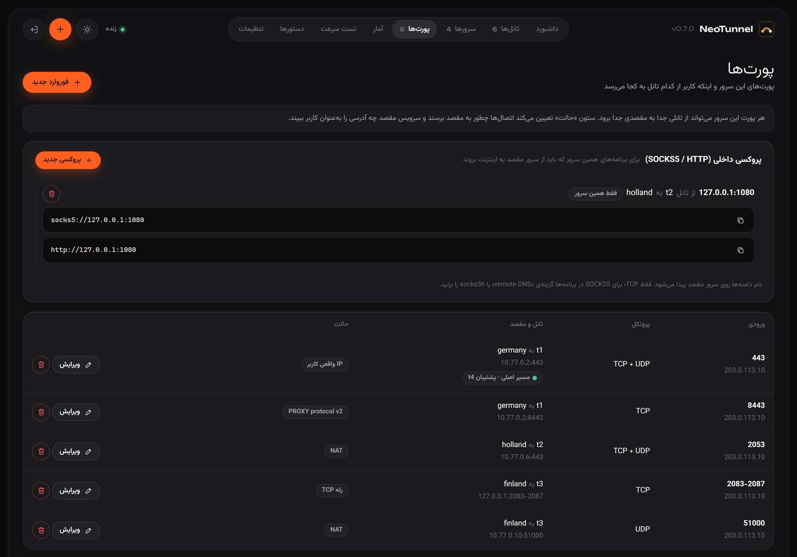
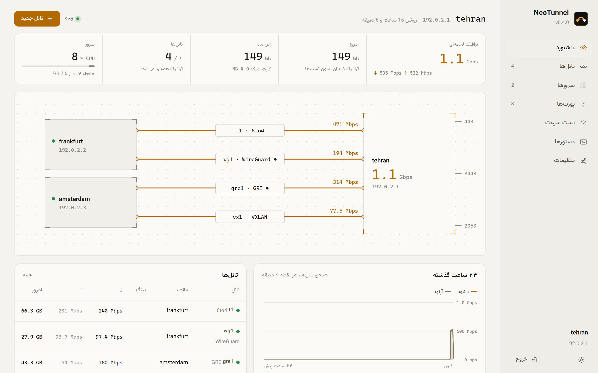
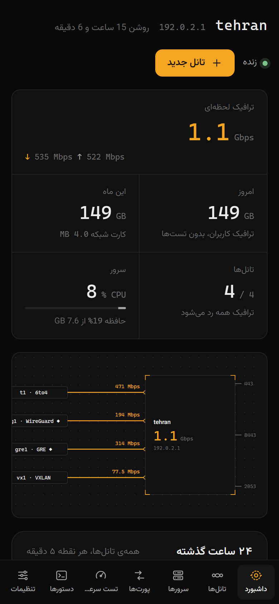
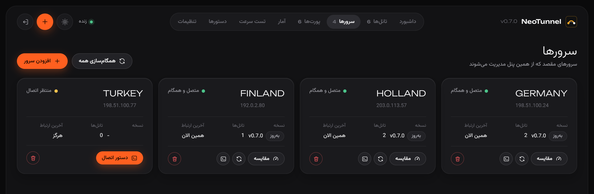

<div dir="rtl">

<p align="center"></p>
<h1 align="center">NeoTunnel</h1>
<p align="center"><b>تانل‌های میکروتیکی روی اوبونتو، با سرعت کرنل و یک پنل فارسی تمیز</b></p>
<p align="center">
<a href="https://github.com/neoauroraproject/neotunnel/releases/latest"></a>
<a href="https://github.com/neoauroraproject/neotunnel/actions/workflows/ci.yml"></a>

<a href="LICENSE"></a>
</p>

<p align="center"></p>

یک سرور (مثلاً ایران) **سرور اصلی** است و پنل روی آن نصب می‌شود. سرورهای مقصد (خارج) با یک دستور به آن وصل می‌شوند و از آن به بعد **هر تغییری در پنل، خودکار روی هر دو طرف اعمال می‌شود**.

<table>
<tr>
<td width="50%">⚡ <b>سرعت کرنل</b><br>تانل‌ها مستقیم در کرنل لینوکس ساخته می‌شوند؛ MTU خودکار، BBR و بافرهای شبکه با یک کلیک.</td>
<td width="50%">🧭 <b>بررسی زنده پیش از ساخت</b><br>هر انتخاب در ویزارد چند ثانیه روی هر دو سرور امتحان می‌شود؛ قبل از ساخت می‌دانید وصل می‌شود یا نه.</td>
</tr>
<tr>
<td>📊 <b>مقایسه‌ی همه‌ی پروتکل‌ها در یک دقیقه</b><br>اول اتصال همه با هم، بعد سرعت فقط برای آن‌هایی که وصل شدند.</td>
<td>🎛️ <b>کنترل کامل هر تانل</b><br>روشن/خاموش، سقف سرعت، حجم ماهانه، رمزنگاری، MTU، پورت.</td>
</tr>
<tr>
<td>👤 <b>IP واقعی کاربر</b><br>حالت شفاف یا PROXY protocol v1/v2، برای TCP و UDP.</td>
<td>🔒 <b>امن و ماندگار</b><br>TLS 1.3 دوطرفه بین سرورها، IPsec در کرنل، سرویس systemd با ترمیم خودکار.</td>
</tr>
</table>

## نصب

روی **سرور اصلی** با دسترسی root:

</div>

```bash
curl -fsSL https://raw.githubusercontent.com/neoauroraproject/neotunnel/main/install.sh | sudo bash
```

<div dir="rtl">

نصاب نسخه‌ی مناسب (amd64 یا arm64) را دانلود و checksum آن را بررسی می‌کند، پنل را روی یک پورت تصادفی بالا می‌آورد و آدرس و رمز را نشان می‌دهد:

</div>

```text
  address   https://203.0.113.10:34127/k7m2xq9p4d/
  username  admin
  password  9hq4m2xkp7wtrn
```

<div dir="rtl">

<details>
<summary>گزینه‌های نصب</summary>

</div>

```bash
# پورت پنل دلخواه
curl -fsSL https://raw.githubusercontent.com/neoauroraproject/neotunnel/main/install.sh | sudo bash -s -- --port 2096
# بدون پنل (سرور مقصد)
curl -fsSL https://raw.githubusercontent.com/neoauroraproject/neotunnel/main/install.sh | sudo bash -s -- --no-panel
# نسخه‌ی مشخص
curl -fsSL https://raw.githubusercontent.com/neoauroraproject/neotunnel/main/install.sh | sudo bash -s -- --version v0.4.0
```

<div dir="rtl">

اجرای دوباره‌ی همان دستور (یا `sudo neotunnel update`) به‌روزرسانی می‌کند و تنظیمات می‌ماند. گواهی پنل self-signed است؛ بار اول هشدار مرورگر را تأیید کنید.

</details>

## شروع در سه قدم

1. **افزودن سرور**: در صفحه‌ی «سرورها» نام و IP سرور خارج را وارد کنید.
2. **اتصال**: دستور یک‌خطی‌ای را که پنل برای همان سرور می‌سازد روی سرور خارج اجرا کنید. برنامه را مستقیم از سرور ایران می‌گیرد (به گیت‌هاب نیازی ندارد).
3. **ساخت تانل**: «تانل جدید» ← مقصد ← پروتکل ← امنیت و پورت ← فوروارد. هر دو طرف ساخته می‌شوند.

<p align="center"></p>

در مرحله‌ی پروتکل، «بررسی سریع همه» همه‌ی انواع را با هم امتحان می‌کند و روی هر گزینه می‌نویسد وصل شد (با پینگ) یا نه. با عوض کردن رمزنگاری یا پورت، همان ترکیب دوباره بررسی می‌شود.

## تست سرعت و مقایسه

</div>

<p align="center"></p>
<p align="center"></p>

<div dir="rtl">

- **تست یک تانل**: پینگ، جیتر، افت و سپس آپلود و دانلود واقعی داخل خود تانل، با عقربه و نمودار زنده.
- **مقایسه**: تانل‌های موقت از هر نوع بین دو سرور ساخته می‌شوند. اول اتصال همه با هم چند ثانیه بررسی می‌شود، بعد سرعت فقط برای آن‌هایی که وصل شدند؛ کل کار حدود یک دقیقه. با یک کلیک، بهترین گزینه ساخته می‌شود. تانل‌های فعلی دست نمی‌خورند و ترافیک تست جزو آمار حساب نمی‌شود.

## مدیریت هر تانل

<p align="center"></p>

هر تانل سه بخش دارد: **نمای کلی** (ترافیک امروز، ماه و کل، آدرس‌ها، لایه‌ها و MTU)، **محدودیت‌ها** و **تنظیمات** (رمزنگاری، MTU، TTL، DSCP، پورت).

<p align="center"></p>

- **سقف سرعت**: هر دو سر روی ارسال خود محدود می‌کنند (TBF در کرنل)، پس دانلود و آپلود هر دو محدود می‌شوند.
- **حجم ماهانه**: وقتی پر شد تانل تا اول ماه بعد خاموش می‌شود و بعد خودش برمی‌گردد.
- **روشن/خاموش**: تانل بدون از دست رفتن تنظیمات روی هر دو سرور پایین می‌آید.

### حالت سرعت

هر تانل یکی از سه حالت را دارد (در ویزارد، زبانه‌ی تنظیمات تانل، یا `--profile` در خط فرمان):

| حالت | چه می‌کند | مناسب برای |
|---|---|---|
| **سبک** (`lean`) | صف‌های کوتاه، کمترین مصرف پردازنده؛ تانل TCP روی ۲ اتصال | پینگ پایدار، ترافیک سبک |
| **متعادل** (پیش‌فرض) | تنظیمات پیش‌فرض کرنل؛ تانل TCP روی ۴ اتصال | بیشتر کاربردها |
| **حداکثر** (`max`) | دریافت بسته‌ها روی همه‌ی هسته‌های پردازنده پخش می‌شود (RPS روی تانل، و روی کارت شبکه اگر صف‌هایش کمتر از هسته‌هاست)، صف ارسال بلندتر؛ تانل TCP روی ۸ اتصال | ترافیک سنگین، سرورهای مجازی با کارت شبکه‌ی تک‌صف |

تانل TCP ترافیک را روی چند اتصال هم‌زمان می‌برد و هر جریان روی یکی از آن‌ها می‌ماند؛ با عوض کردن حالت، تعداد اتصال‌ها بدون قطع شدن تانل تغییر می‌کند.

## انواع تانل

| نوع | لایه | بستر | روی پورت | معادل میکروتیک |
|---|:-:|---|:-:|---|
| **6to4** (SIT + IPIP6) | 3 | IPv4 | UDP | 6to4 + IPIPv6 |
| 6to4-gre (SIT + GRE6) | 3 | IPv4 | UDP | 6to4 + GREv6 |
| IPIP / SIT | 3 | IPv4 یا IPv6 | UDP (روی IPv4) | IPIP / 6to4 |
| GRE / GRETAP | 3 / 2 | IPv4 یا IPv6 | UDP (روی IPv4) | GRE |
| **EoIP / EoIPv6** | 2 | IPv4 یا IPv6 | UDP | EoIP (با tunnel-id یکسان) |
| VXLAN / GENEVE | 2 | IPv4 یا IPv6 | همیشه UDP | VXLAN |
| L2TPv3 | 2 | IPv4 یا IPv6 | UDP یا IP 115 | L2TPv3 ایستا |
| **WireGuard** (رمزدار) | 3 | IPv4 یا IPv6 | همیشه UDP | WireGuard (RouterOS 7) |
| **NeoObfs** (رمزدار، مبهم) | 3 | IPv4 یا IPv6 | همیشه UDP | — |
| **TCP** (آخرین راه) | 3 | IPv4 یا IPv6 | همیشه TCP | — |

- **بستر IPv6**: اگر هر دو سرور IPv6 دارند، در ویزارد «IPv6» را بزنید؛ آدرس‌ها خودکار پیدا می‌شوند و GRE و IPIP به نسخه‌ی IPv6 خود تبدیل می‌شوند.
- **TCP** برای مسیرهایی است که نه UDP رد می‌کنند و نه پروتکل خام؛ TCP روی TCP زیر افت بسته کند می‌شود، پس فقط وقتی بقیه وصل نشدند.
- **رمزنگاری**: IPsec در کرنل (AES-GCM یا ChaCha20) برای هر تانل کرنلی، با کلیدهایی که از رمز مشترک خود تانل ساخته می‌شوند؛ یا WireGuard، NeoObfs و TCP رمزدار.
- **MTU خودکار**: با «اندازه‌گیری مسیر»، MTU واقعی مسیر پیدا و با سربار همه‌ی لایه‌ها تنظیم می‌شود و هر ۳۰ دقیقه دوباره سنجیده می‌شود.

## فوروارد پورت و IP واقعی کاربر

<p align="center"></p>

هر پورت این سرور می‌تواند از تانلی جدا به مقصدی جدا برود (مثلاً 443 به آلمان، 2053 به 443 هلند). سرویس مقصد کاربر را این‌طور می‌بیند:

| حالت | سرویس مقصد چه می‌بیند | TCP / UDP |
|---|---|---|
| `nat` (پیش‌فرض) | آدرس داخلی تانل | هر دو |
| `transparent` | IP واقعی کاربر، بدون هیچ تنظیمی در برنامه (مقصد باید NeoTunnel داشته باشد) | هر دو |
| `proxy` | هدر PROXY protocol v1/v2 برای nginx، HAProxy، Xray | TCP؛ UDP با v2 |

## پنل، روی هر صفحه‌ای

</div>

<table>
<tr>
<td width="68%"></td>
<td width="32%"></td>
</tr>
<tr>
<td colspan="2"></td>
</tr>
</table>

<div dir="rtl">

تم تیره و روشن، چیدمان موبایل، و صفحه‌ی «دستورها» که هر کار پنل را با IP و نام واقعی سرورهای شما آماده‌ی کپی نشان می‌دهد. پنل فقط چیزهایی را که عوض شده به‌روز می‌کند، پس ترافیک زنده بدون پرش و ریلود جلو می‌رود.

## خط فرمان

همه‌ی کارهای پنل از ترمینال هم انجام می‌شود؛ `sudo neotunnel` منوی تعاملی را باز می‌کند.

</div>

```bash
sudo neotunnel quick germany --address 198.51.100.24 --forward 443          # 6to4 + فوروارد در یک مرحله
sudo neotunnel quick holland --address 203.0.113.57 --mode gre --port 3001 \
     --encrypt aes-gcm-128 --forward 2053 --forward-to 443                  # GRE رمزدار روی UDP
sudo neotunnel tunnel add mk1 --kind eoip --remote 203.0.113.99 --tunnel-id 10   # EoIP به میکروتیک
sudo neotunnel tunnel limit t1 --rate 200 --quota 500                        # سقف سرعت و حجم
sudo neotunnel bench germany                                                 # مقایسه‌ی همه‌ی انواع
```

<div dir="rtl">

| دستور | کار |
|---|---|
| `quick <server> --address <ip> [--mode] [--port] [--forward] [--encrypt] [--obfs]` | ساخت تانل در یک مرحله |
| `tunnel add\|set\|list\|remove\|kinds` | مدیریت تانل‌ها و تنظیمات پیشرفته |
| `tunnel enable\|disable\|limit <name>` | روشن/خاموش، سقف سرعت و حجم ماهانه |
| `tunnel set <name> --profile lean\|balanced\|max` | حالت سرعت |
| `forward add\|set <tunnel> <ports> [--to] [--proto] [--mode nat\|transparent\|proxy]` | فوروارد پورت |
| `peer add\|list\|link\|sync\|upgrade\|remove` | سرورهای مقصد |
| `test <tunnel>` / `bench <server>` / `mtu <tunnel>` | تست سرعت، مقایسه، بهترین MTU |
| `traffic` / `status` / `doctor` | ترافیک زنده، وضعیت و عیب‌یابی |
| `panel info\|setup\|password\|port\|disable` | مدیریت پنل |
| `boost` / `update` / `uninstall` | تنظیم شبکه، به‌روزرسانی، حذف کامل |

## امنیت و پورت‌ها

| پورت | کاربرد |
|---|---|
| پورت پنل (تصادفی) | پنل وب روی یک آدرس مخفی؛ رمز با bcrypt و قفل بعد از ۵ تلاش ناموفق |
| 7710/tcp | ارتباط سرورها: TLS 1.3 دوطرفه با کلیدهای pin‌شده |
| 7711/tcp+udp | ترافیک تست سرعت، فقط برای نشست‌هایی که سرور اصلی باز کرده |

اگر ufw فعال باشد، پورت‌ها و پروتکل‌های لازم (از جمله GRE از سمت سرور مقابل) خودکار باز می‌شوند. پورت‌های 22، 7710 و 7711 هرگز فوروارد نمی‌شوند.

## سؤال‌های رایج

<details>
<summary><b>تانل ساخته شد ولی ترافیک رد نمی‌شود.</b></summary>

احتمالاً مسیر پروتکل خام (41 یا 47) را نمی‌گذارد. در ویزارد «بررسی سریع همه» را بزنید یا تانل را روی یک پورت UDP بسازید. اگر هیچ UDP‌ای رد نشد، TCP را امتحان کنید. `sudo neotunnel doctor` هم مشکلات رایج را پیدا می‌کند.
</details>

<details>
<summary><b>دومین 6to4 یا IPIP به همان سرور ساخته نمی‌شود.</b></summary>

کرنل بین دو آدرس فقط یک تانل SIT یا IPIP بی‌کلید می‌پذیرد، حتی روی پورت UDP؛ برای دومی GRE، GENEVE یا نوع دیگری بسازید.
</details>

<details>
<summary><b>ترافیک دیتاسنتر با آمار پنل فرق دارد.</b></summary>

پنل ترافیک کاربران را جدا از تست‌ها نشان می‌دهد و ترافیک کارت شبکه (همان چیزی که دیتاسنتر حساب می‌کند) را هم کنارش می‌آورد؛ سربار لایه‌های تانل باعث فرق کوچک بین این دو است.
</details>

<details>
<summary><b>حذف کامل</b></summary>

`sudo neotunnel uninstall` تانل‌ها، IPsec، قوانین، تنظیمات و خود برنامه را پاک می‌کند؛ با `--keep-config` تنظیمات می‌ماند.
</details>

## ساخت از سورس

</div>

```bash
go test ./...
GOOS=linux GOARCH=amd64 go build -o dist/neotunnel-linux-amd64 ./cmd/neotunnel
sudo test/e2e.sh dist/neotunnel-linux-amd64   # تست کامل روی کرنل واقعی
```

<div dir="rtl">

## مجوز

[MIT](LICENSE)

</div>
